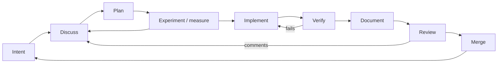

# Software Development Life Cycle

How a human and an AI coding agent (Claude Code) build a Unity
project together on top of a repo harness. This is the process we
settled on after two multi-phase epics: a feature epic (new gameplay
systems, UI and assets) and a balance epic (formula rework driven by
a simulator). It is project agnostic: swap in your own game, your own
features and your own metrics.

---

## 1. Roles

| Who | Owns |
|---|---|
| **User** | Intent, priorities, taste, approvals, merges, releases. Decides what "done" means. |
| **Agent** | Investigation, proposals, implementation, verification, documentation, PR plumbing. Brings options and a recommendation, then executes. |
| **Harness** | Shared memory. Whatever must survive a session (scope, state, decisions, rules, rejected ideas) lives in the repo, not in the chat. |
| **Tools** | Unity CLI, `gh`, subagents, scripts. They turn "the agent can write code" into "the agent can prove the code works" without the user at the keyboard. |

The user steers and the agent rows. The user should never have to
remember project state: if it matters, it is in the harness.

---

## 2. The cycle at a glance



Two loops matter more than the straight line:

- **Experiment → Discuss.** Numbers come back, the user reacts, and
  the plan changes. Most good decisions in a balance epic came from
  this loop.
- **Review → Discuss.** A review comment opens a discussion. It is
  not a work order.

---

## 3. Stages

### 3.1 Intent

The user states a goal, often loosely and with several asks in one
message ("the first level feels too easy, this enemy should hit
harder, and can we spread the enemy types out?").

Agent:
- Split the message into independent asks. If they are truly
  independent, run them in parallel with subagents.
- Restate each ask in one line before acting on it.
- Notice what was *not* asked. Answering a question is not
  permission to change code.

### 3.2 Discuss

This stage turns loose intent into a decision the user has
explicitly agreed to.

Agent:
- Reply in **numbered points** that mirror the user's own
  numbering, so they can answer "1 yes 2 I don't understand 3 ok".
- Give a **recommendation, not a survey**. One preferred option,
  why, and at most one alternative worth weighing.
- When the user says "I don't understand", rewrite the point in
  plain language with a concrete example or a small table. Don't
  repeat the jargon louder.
- Ask only questions that block. Pick conventional defaults
  yourself and say so.
- **No code until approved.** Reporting a finding (a warning, a
  bug, a balance problem) is not a request to fix it.
- If you misread something, say so plainly and correct course
  ("I took 'the limit' as the spawn limit; you meant the damage
  limit").

Checklist:
- [ ] Every ask restated and answered by number
- [ ] One recommendation per open decision
- [ ] Explicit user approval recorded before any code
- [ ] Decisions written into the harness right away (see §3.7)

### 3.3 Plan

For anything bigger than one PR, write a plan.

- `harness/plans/<epic>.md`: goal, phases, what each phase changes,
  how each phase is verified, open questions.
- `harness/feature_list.json`: one entry per phase or feature, with
  `behavior` (what it does and why), `verification` (how we prove
  it) and `state` (`not_started` / `active` / `passing` / `blocked`
  / `idea`).
- **Epic branches:** an epic gets its own branch off `main`, and
  each phase gets `<epic>-<feature-id>` stacked on the previous one
  (see §3.5).
- Ideas the user mentions in passing get an `idea` entry, so they
  aren't lost and aren't silently scheduled either.

Checklist:
- [ ] Plan file exists and names a verification for every phase
- [ ] feature_list entries created with behavior + verification
- [ ] Phases small enough to review on their own

### 3.4 Experiment / measure

**Measure before you tune.** If the decision depends on numbers,
build the instrument first:

- **A headless simulator** that drives the real rules with a fixed
  bot policy, seeded per run so results are reproducible and can
  be chunked.
- **Reports that answer the user's actual question:**
  - Where do runs end?
  - How much damage per level band, and from what?
  - How many hits does each enemy take?
  - How often is each drop slot starved?

  When the user asks "can we see X?", add a report for X rather
  than estimating it.

How experiments run:
- They go on a **local scratch branch**, change **one knob at a
  time**, and run on **several seeds**.
- They are **reverted** afterwards. Only the winner is built for
  real, on its feature branch.
- **Rejected variants are recorded** with their numbers and the
  reason, in the plan, the feature entry or the balance doc. "We
  tried X and it did Y" saves the next session from trying it
  again.
- Results are reported as **before → after**, in a compact table:

  | seed | median | p90 | max | endless |
  |---|---|---|---|---|
  | A | 45 (43) | 61 (60) | 92 (116) | 0 |

Checklist:
- [ ] Measurement exists before any tuning
- [ ] Baseline captured on the same seeds
- [ ] Every variant reverted; winners and losers both written down

### 3.5 Implement

Branching:
- One feature per branch.
- For an epic, use stacked PRs: phase 1 targets the epic branch,
  and each later phase targets the previous phase's branch.
- Link the stack: `gh stack link --base <epic> <pr> <pr> ...`. Never
  omit `--base`.

Commits:
- Small and focused, with a **single-line message** and no body.
- Check `git status` and `git log` right before committing, because
  the user may have committed in between.

Code:
- Follow `harness/docs/CODE_STYLE.md` (line length, naming, comment
  policy, where assets live).
- Build only what is called: **no dead code** (unused overloads,
  write-only fields, "might need it later" helpers).
- **Unify incidental duplication.** When two things differ only
  because they were built in different sessions, merge them.
- Instance data that should be stable is **fixed at creation**. A
  picked-up item keeps the roll it got at drop and is never
  recomputed from current context.
- Generated assets (placeholder art, textures) come from a
  committed or scratch script, keep the existing style, and ship
  with their `.meta` files.

Checklist:
- [ ] Branch name and PR base match the stack
- [ ] No dead code, no stray debug code
- [ ] `.meta` files alongside every new asset

### 3.6 Verify

The agent proves the change works before claiming it does. With the
Unity CLI this needs no human:

- **Compile:** `unity cmd recompile`, then poll `recompile_status`.
- **Tests:** `unity cmd run_tests --mode EditMode`, plus PlayMode
  tests where they exist.
- **Play:** `editor_play`, drive the game via `eval` (send input
  events, read state), `capture_game_view` for screenshots, then
  `editor_stop`.
- **Inspect:** `unity cmd eval '<C#>'` to dump derived data (spawn
  pools per level, unlock levels, computed stats) instead of guessing.
- **Simulate:** run the simulator on 3 seeds × 1000 runs for any
  balance-affecting change.

Report faithfully:
- Failures are shown with their output.
- Skipped steps are named.
- When something is verified, say so plainly, without hedging.

Checklist:
- [ ] Compiles clean
- [ ] All tests pass (count reported)
- [ ] Visual changes captured; balance changes simulated on
      multiple seeds

### 3.7 Document

Documentation happens **inline, in the same change**, not at the
end:

- Keep these current:
  - `feature_list.json` state and notes
  - `progress.md` (a short paragraph per finished unit of work)
  - `harness/docs/*` (formulas, architecture, notes)
- Record **decisions and rejected alternatives**, not just what
  shipped.
- At close-out, move every `passing` entry to `feature_archive.json`,
  including ones that passed this session. The feature list should
  only hold open work.
- Write a doc change into the PR it belongs to. Docs that belong to
  no particular PR go in one docs-only commit on top of the stack.

Checklist:
- [ ] feature_list / progress / docs updated in the same PR
- [ ] Rejected options recorded with numbers and reasons
- [ ] Passing features archived at close-out

### 3.8 Review

- The user reviews the stack **bottom-up**.
- The agent reads PR comments and **discusses them first**: what
  the reviewer means, options, a recommendation. It changes nothing
  until the user approves.
- **Review tweaks are shown before they are committed.** Make the
  change, verify it, show the result (diff, capture, numbers), then
  commit and push only after the user says OK.
- After the fix lands, reply on each thread and resolve it.
- If an earlier phase changes, rebase the later phases onto it.
  Never merge.

### 3.9 Merge

- **Only the user merges.** The epic lands on `main` when the user
  says so; the agent does not propose it.
- History stays linear: PRs are **rebase-merged**, with no merge
  commits and no squash unless the user asks.
- **Force-push needs explicit approval every time.** A past approval
  does not carry forward.

---

## 4. How the harness supports each stage

| Harness piece | Role | Stages |
|---|---|---|
| `AGENTS.md` | Entry point, read first every session: overview, hard constraints, how to run and verify. | all |
| `CLAUDE.md` | One line pointing to `AGENTS.md`. | all |
| `harness/docs/` | Architecture, code style, engine notes, balance formulas, loop mechanics. | plan, implement, document |
| `harness/plans/` | Multi-phase plans with per-phase verification. | plan |
| `harness/feature_list.json` | Open work: behavior, verification, state. | plan → document |
| `harness/feature_archive.json` | Finished or dropped work, with results. | document |
| `harness/progress.md` | Session continuity: current state, decisions, blockers, next step. | every session |
| `harness/clean-state-checklist.md` | Definition of "session done". | close-out |
| `harness/scripts/` | Repeatable tooling (feature loop, simulator, generators). | experiment, verify |
| Agent memory files | Durable feedback about how the user wants to work. | all |

The rule underneath all of it: **a session's state never lives
only in the conversation.** A fresh agent with an empty context can
read `AGENTS.md` and `progress.md` and continue.

---

## 5. Tools

- **Unity CLI: the autonomy unlock.** Before it, every compile
  check, test run and screenshot needed the user. With it, the
  agent compiles, tests, plays, captures and evaluates C# in the
  live Editor on its own. Note its quirks in
  `harness/docs/UNITY_NOTES.md` (e.g. `eval` times out at about 5 s,
  so long jobs are chunked).
- **`gh` CLI.** PRs, stacked PR linking, reading and replying to
  review comments, resolving threads.
- **Subagents:**
  - for independent asks in one message
  - for experiments that would flood the main context with output
  - for long runs
  - with a precise brief: scope, files not to touch, branch rules,
    what to report back
- **Background tasks.** Long simulations or builds run in the
  background, and the agent gives a short status line instead of
  going silent.
- **Notifications.** Only when the user has likely walked away, or
  a decision blocks progress.

---

## 6. Working agreements

These come from real corrections. Each one has cost a round trip.

**Safety and the user's machine**
- Never install anything (pip, npm, brew, gems, packages) without
  asking first, even "just to inspect".
- Never edit generated folders (`Library/`, `Temp/`, `Logs/`,
  `UserSettings/`) or relocate engine-scaffolded assets.

**Git**
- Check `git status` and `git log` before every commit or branch
  operation.
- Use single-line commit messages, with no body and no trailer
  unless the project says otherwise.
- Keep history linear: rebase or cherry-pick, never `git merge`.
  Prefer cherry-picking individual commits when adopting side-branch
  work.
- Never merge PRs. Never force-push without explicit approval each
  time. Never touch the epic branch or `main` directly.
- Don't suggest landing the epic until the user raises it.

**Collaboration**
- Discuss before coding on findings.
- On open PRs, show review tweaks and wait for an OK before
  committing.
- Run independent asks in parallel with subagents.
- Trust tool and file-change notifications. Don't re-read what you
  were just shown.

**Code quality**
- No dead code.
- Unify incidental duplication.
- Keep naming consistent within its register (full words for
  effect/enum names, established abbreviations for data fields;
  write the project's convention down in CODE_STYLE).
- Follow domain rules exactly as the user defines them. Write
  non-obvious mechanics into the docs so nobody re-derives them
  wrong.

**Tracking**
- Update feature_list / progress inline, every time scope or state
  changes.
- Archive passing features at close-out, same session included.

---

## 7. Communication patterns that worked

- **Numbered replies** that mirror the user's numbering.
- **A recommendation**, not a menu.
- **Numbers as before → after**: "median 43 → 45, p90 61 → 62, max
  116 → 92".
- **Tables** for any comparison of three or more options or seeds.
- **Plain language on request.** Swap jargon for a concrete example.
  ("A value of 10 gives 50%, 30 gives 61%, and nothing
  reaches the 70% ceiling.")
- **Honest caveats.** Say what the numbers don't show and which
  target was missed, and why ("this enemy gets easier the longer it
  appears; keeping it at 3+ hits means starting at 5").
- **Say when a plan changed.** If the agreed approach was dropped
  for a measured reason, state it at the top of the report.
- **Short status lines** during long work ("Tuning landed; fixing
  four tests that pin the old values").
- **Admit misreads** in one sentence and move on.

---

## 8. Lessons learned

1. **Measure first.** A report that answers the question beats any
   amount of reasoning about the formula.
2. **Turn one knob at a time, on several seeds.** Single-seed wins
   are noise.
3. **Record rejected experiments.** Each one is a future "why don't
   we just…" already answered.
4. **Derived values beat hand-authored numbers, but watch the
   coupling.**
   - Deriving placement from stats means adding content never
     shifts other content.
   - But a lever that looks local (the difficulty curve) can starve
     another range (deep content went toothless).
   - Check the extremes after every change.
5. **Fix instance data at creation.** If the user thinks of an
   object as "the thing I picked up", its numbers must not drift
   with later context. Growth comes from new instances rolling
   better, not from old ones changing.
6. **Mind structural changes as well as numbers.** Reducing variety
   (fewer enemy types per level) removed the easy filler that was quietly
   carrying the difficulty. Re-baseline after structural changes,
   not just numeric ones.
7. **Docs ship with the change.** A formula doc that lags one PR
   behind is a bug report waiting to happen.
8. **The harness is cheap; lost context is expensive.** Writing
   progress down takes minutes, and rediscovering it costs a
   session.

---

## 9. Session rhythm

```
Start of session
  read AGENTS.md → progress.md → feature_list.json
  check git status / branches / open PRs

During
  discuss → (plan) → (experiment) → implement → verify → document
  update tracking inline at every state change

Close-out
  run harness/clean-state-checklist.md
  archive passing features
  progress.md: what changed, decisions, blockers, next step
  leave open PRs noted, nothing uncommitted unless awaiting approval
```

See `SUBAGENTS.md` for the subagents and skills that would automate
more of this cycle.
